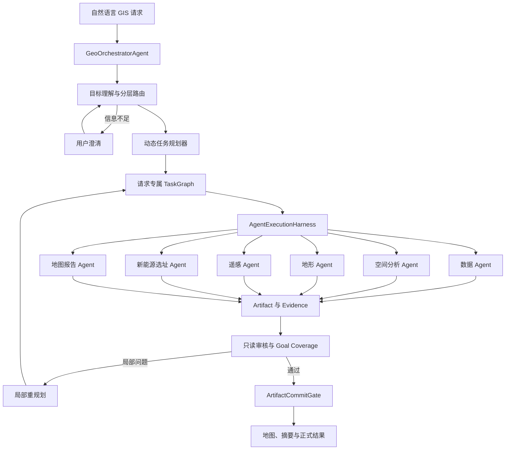
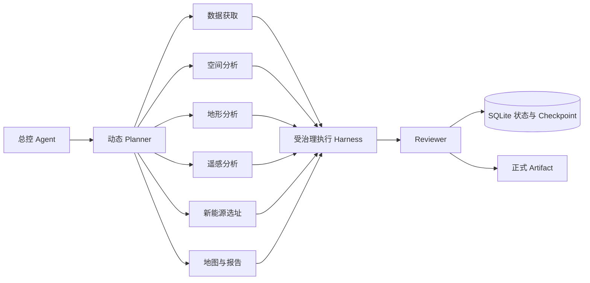
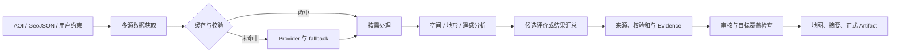

# Atlas

> 地理空间分析与新能源选址 Agent

[](https://www.python.org/)
[](https://fastapi.tiangolo.com/)
[](LICENSE)
[](https://github.com/ni1110/Atlas-Geospatial-Intelligence/actions/workflows/ci.yml)

Atlas 是一个面向自然语言 GIS 请求的分层式多 Agent 地理空间分析系统。系统由
`GeoOrchestratorAgent` 统一接收用户目标，使用智谱 GLM 完成目标理解和动态任务规划，
再按需调度数据、空间分析、地形、遥感、新能源选址、地图报告和审核 Agent。

项目关注的不只是“调用一个 GIS 工具”，而是如何让多步骤空间任务在真实工程环境中
可靠执行：每个 Agent 只能访问自己的工具和工作区；执行过程包含超时、重试、熔断、
缓存复用、断点恢复和证据追踪；最终结果必须通过审核与提交门禁后才能对外发布。

新能源选址是 Atlas 的一项复合业务能力，而不是系统的唯一用途。

## 项目背景

实际 GIS 任务通常包含目标澄清、数据获取、坐标与几何处理、多步空间计算、结果审核
和地图表达。固定工作流难以覆盖差异明显的请求，直接开放全部工具又会带来越权操作、
重复执行、长任务中断和结果不可追溯等问题。

Atlas 将这些问题拆分为三个层次：

1. **决策层**：理解目标，识别缺失信息，动态生成与请求匹配的任务图。
2. **执行层**：专业 Agent 通过受治理 Harness 调用有限工具，输出 Artifact 与 Evidence。
3. **治理层**：统一处理权限、可靠性、审核、局部重规划和最终结果提交。

## 系统整体架构



正常路径由真实大模型完成路由和规划；当模型调用失败、超时或结构化输出不符合治理
规则时，确定性 Router/Planner 才接管。两类指标分别记录，不会把 fallback 伪装成
LLM 执行。

## Agent 与模块关系



每个专业 Agent 都有独立工具白名单和工作空间，不能修改用户原始数据、模型、系统配置、
其他 Agent 工作区或最终结果。只有总控 Agent 能够委派任务，只有提交门禁能够提升正式
Artifact。

## 数据处理流程



## 当前能力边界

Atlas 对“已注册工具”和“已用真实数据验收的能力”做明确区分：

| 能力类别 | 当前状态 | 说明 |
| --- | --- | --- |
| Buffer | 已真实验证 | 使用受治理 GeoJSON 输入执行真实几何缓冲 |
| Buffer + Intersection | 已真实验证 | 多步 TaskGraph、真实几何结果和校验和均已验证 |
| DEM Statistics / Slope | 已验证 | 使用已验收 Copernicus DEM 缓存计算统计与坡度 |
| Sentinel STAC 检索 | 已联网验证 | 仅检索 item/asset metadata，不下载完整场景 |
| Clip / Dissolve / Spatial Exclusion | 已实现 | 具备几何实现，尚未逐项完成独立公开验收 |
| Spatial Join / Nearest Distance / Zonal Statistics | 规划能力 | 已进入工具治理与规划表面，不能视为已独立验收算法 |
| Aspect | 待完善 | 工具路径存在，当前不能宣称已输出完整坡向结果 |
| Raster Window / NDVI / RGB | 明确未验收 | 冻结验收中标记为 `SKIPPED`，不伪造影像产品 |
| 新能源选址 | 复合能力 | 串联数据、地形、GIS、评分与报告；正式路径可复用已验收缓存证据 |

## 核心技术设计

### 1. LLM-first 路由与动态规划

路由器首先生成结构化 GoalContract，保留 AOI、硬约束、预期输出和缺失字段。Planner
根据目标、可用 Agent、工具范围、已有 Artifact/Evidence 和执行状态生成请求专属
TaskGraph，而不是把所有请求塞入同一固定 Workflow。

### 2. Tool 调用治理

Planner 只能选择 Agent 白名单内的工具；Harness 在实际调用前再次校验权限。系统将
“计划调用”和“实际调用”分开记录，只有经过授权并真实尝试的操作才进入
`actual_tool_calls`。

### 3. 可靠性与长任务恢复

执行器统一实现错误分类、超时、自动重试、指数退避、熔断、预算限制和死循环检测。
任务状态、Attempt、Artifact 和 Checkpoint 持久化到 SQLite，进程恢复后可以复用
校验和有效的成功节点，避免整条任务链重新运行。

### 4. 安全与权限隔离

Agent Harness 为每个角色创建独立 Workspace，并限制文件路径和工具范围。路径越界、
跨 Agent 写入、配置/模型修改和直接写入最终目录都会被拒绝；ArtifactCommitGate 在
正式结果提交前验证类型、依赖、来源与校验和。

### 5. 多源数据与容错

数据层支持 geoBoundaries、Copernicus DEM、ESA WorldCover、JRC、OSM、NASA POWER、
Copernicus Sentinel STAC 和 Planetary Computer fallback。Provider 状态、缓存命中和
数据来源会写入结果，避免把缓存结果描述成实时联网结果。

### 6. 可观测性与证据链

状态接口分别暴露 Intent、GoalContract、TaskGraph、实际 Agent Attempt、Tool Call、
Artifact、Evidence、Review 和 Replan。面向用户的页面默认展示中文结论和地图，技术
细节折叠保存，兼顾产品体验和工程排障。

## 技术亮点

- 智谱 GLM + Strands Agents 的真实结构化路由与规划。
- 请求级动态任务图和多专业 Agent 协作，而非固定工作流。
- 确定性 fallback 与真实 LLM 指标分离。
- Agent 工具白名单、独立 Workspace 和最终 Artifact 提交门禁。
- 超时、重试、熔断、执行预算、断点恢复和幂等复用。
- Provider fallback、缓存校验、来源记录和执行类型标注。
- 用户澄清链：补充信息后继续同一个 Job/Goal。
- 地图、中文摘要与可折叠执行详情的一体化 Demo。

## 快速开始

### 环境要求

- Python 3.11 或更高版本
- Windows、Linux 或 macOS
- 智谱 API Key（仅真实 LLM 路由/规划需要）

### 安装

```bash
git clone https://github.com/ni1110/Atlas-Geospatial-Intelligence.git
cd Atlas-Geospatial-Intelligence
python -m venv .venv
```

Windows PowerShell：

```powershell
.\.venv\Scripts\Activate.ps1
python -m pip install --upgrade pip
pip install -e ".[zhipu]"
```

Linux / macOS：

```bash
source .venv/bin/activate
python -m pip install --upgrade pip
pip install -e ".[zhipu]"
```

### 配置智谱 GLM

密钥只通过环境变量读取，不要写入源码、配置文件、日志或请求体。

```powershell
$env:ZHIPUAI_API_KEY = "在当前终端安全设置"
$env:GEOAGENT_MODEL_PROVIDER = "zhipu"
$env:GEOAGENT_MODEL_ID = "glm-4.5-flash"
$env:GEOAGENT_MODEL_BASE_URL = "https://open.bigmodel.cn/api/paas/v4/"
```

仓库提供 [.env.example](.env.example) 作为变量名参考，但应用不会自动加载或提交
`.env`。完整说明见 [快速开始](docs/getting-started.md)。

### 启动

```powershell
python -m geoagent.cli serve --port 8000
```

启动后访问：

- 主 Demo：<http://127.0.0.1:8000/geoagent/demo>
- 新能源选址页面：<http://127.0.0.1:8000/>
- OpenAPI：<http://127.0.0.1:8000/docs>
- 健康检查：<http://127.0.0.1:8000/health>

### 示例请求

```bash
curl -X POST http://127.0.0.1:8000/v1/geo/jobs \
  -H "Content-Type: application/json" \
  -d '{
    "user_query": "对甘肃小范围 AOI 进行地形与遥感可用性分析，并生成来源摘要",
    "region_or_aoi": {
      "bbox": [102.99885, 37.59704, 103.09885, 37.69704],
      "crs": "EPSG:4326"
    }
  }'
```

更多请求见 [examples/requests.http](examples/requests.http)。

## 项目目录

```text
Atlas-Geospatial-Intelligence/
├─ geoagent/orchestration/        # 总控、路由、Planner、TaskGraph、Harness 与安全治理
├─ geoagent/core/                 # Strands 模型抽象与兼容接口
├─ geoagent/tools/                # 可选地理工具适配层
├─ renewable_site_agent/          # 新能源复合能力、数据层、可靠性与持久化
├─ qgis_geoagent/                 # QGIS 兼容插件代码
├─ config/                        # 数据源、模型、路径、可靠性和评分策略
├─ evals/                         # 路由、规划、安全、可靠性和 Provider 评测入口
├─ examples/                      # 可复现 API 请求示例
├─ tests/                         # 单元、集成、安全和故障注入测试
├─ docs/                          # 架构、工作流、设计与验收边界文档
└─ .github/workflows/ci.yml       # 无密钥公开 CI
```

## 设计文档

- [系统架构](docs/architecture.md)
- [任务工作流](docs/workflow.md)
- [关键设计决策](docs/design.md)
- [安装与运行](docs/getting-started.md)
- [验证结果与能力边界](docs/validation.md)

## 测试

公开 CI 不调用付费模型、不下载大模型，也不下载 Sentinel 完整场景：

```bash
pytest tests/test_public_smoke.py -q
python -m compileall -q geoagent/orchestration renewable_site_agent
mkdocs build --strict
```

完整本地测试和真实 Provider/LLM Eval 需要相应缓存、凭据及显式授权，不应在普通 CI
中自动运行。

## 开源许可与来源

本项目使用 [MIT License](LICENSE)。上游基础代码和修改说明见 [NOTICE.md](NOTICE.md)。
外部地理数据继续遵循各 Provider 的许可与署名要求。
