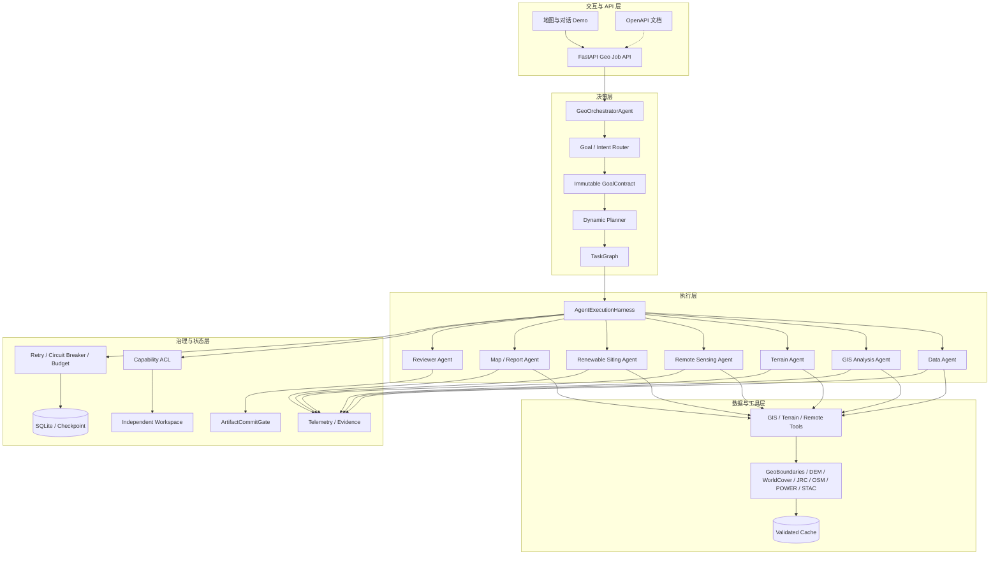

# Atlas 系统架构

## 1. 架构目标

Atlas 解决的是开放式 GIS 请求的可靠执行问题。用户只描述目标，系统负责判断任务类型、
识别缺失信息、生成任务图、限制 Agent 权限、调用地理工具并交付带来源的结果。

架构不以某一种业务为中心。基础空间运算、地形分析、遥感检索和新能源选址共享同一
编排与治理底座，但会生成不同执行路径。

## 2. 分层架构

## 3. 核心组件职责

### GeoOrchestratorAgent

- 持有用户 Goal，专业 Agent 不能修改 GoalContract。
- 协调 Router、Planner、Harness、Reviewer 和最终提交。
- 只对失败节点执行有限次数的局部重规划。
- 在提交前执行确定性 Goal Coverage 检查。

### Goal / Intent Router

- 使用结构化 LLM 输出识别任务类型和所需 Agent。
- 保留 AOI、硬约束、期望结果和缺失信息。
- 多领域请求采用角色并集，避免后命中领域覆盖前一个领域。
- LLM 不可用时才启用确定性 fallback，并记录原因。

### Dynamic Planner

- 输入 GoalContract、Agent 工具表、已有 Artifact/Evidence、Provider 状态和执行预算。
- 输出有向无环 TaskGraph，支持依赖、并行和幂等签名。
- 对跨角色工具、未知工具、超预算节点和循环依赖执行治理校验。

### AgentExecutionHarness

- 统一执行专业 Agent，不允许专业 Agent 再次委派。
- 通过 ToolInvoker 记录真实调用、耗时、Provider 和执行类型。
- 每个节点生成 ArtifactRef 与 EvidenceRef。
- 支持任务去重、成功节点复用和冲突处理。

### Workspace 与 ArtifactCommitGate

- 每个 Job、Agent 和任务使用受控目录。
- 阻止路径越界、跨 Agent 写入和直接修改正式目录。
- 最终提交校验 Artifact 类型、依赖、校验和、Contract 和生产者身份。

### Durable State 与 Reliability

- SQLite 保存 Job、TaskGraph、Attempt、Checkpoint、Evidence、Review 和 Replan。
- 执行器统一处理超时、重试、指数退避、熔断、预算和循环检测。
- 崩溃恢复只重跑未完成节点，校验和有效的结果可以幂等复用。

## 4. 专业 Agent 与工具边界

| Agent | 主要职责 | 工具范围示例 |
| --- | --- | --- |
| Data | AOI、目录和数据窗口 | boundary、catalog、AOI window、cache lookup |
| GIS Analysis | 矢量和空间关系处理 | buffer、intersect、clip、dissolve |
| Terrain | DEM 与地形指标 | acquire DEM、statistics、slope、aspect surface |
| Remote Sensing | 遥感目录与按需处理 | STAC search、band selection、window/NDVI/RGB surface |
| Renewable Siting | 候选地评价 | score、rank、capacity/area check |
| Map / Report | 地图和来源摘要 | add result、render map、generate report |
| Reviewer | 只读审核 | schema、geometry、provenance、goal coverage |

工具出现在白名单中不代表已完成实景验收。准确边界见[验证文档](validation.md)。

## 5. 数据流

1. API 将用户请求、AOI、约束和输入 Artifact 交给总控。
2. Router 生成 Intent 和 GoalContract；缺少关键字段时返回用户澄清。
3. Planner 生成请求专属 TaskGraph，并将 Agent 工具限制写入节点。
4. Harness 根据依赖执行节点；独立节点可以并行。
5. ToolInvoker 记录实际执行类型：Live、Cache、Offline 或 Skipped。
6. Agent 输出写入隔离 Workspace，并生成 Evidence。
7. Reviewer 和确定性 Goal Coverage 检查结果完整性。
8. ArtifactCommitGate 将通过审核的结果提升到正式目录。
9. API 和 Demo 消费状态、地图数据和中文摘要。
