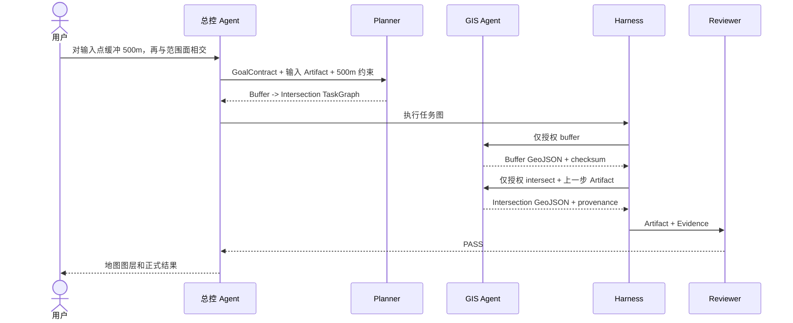
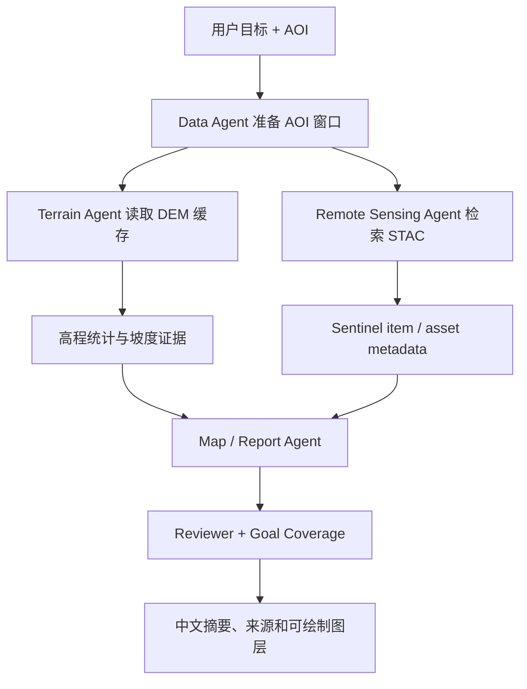
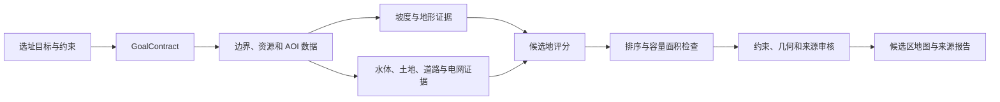
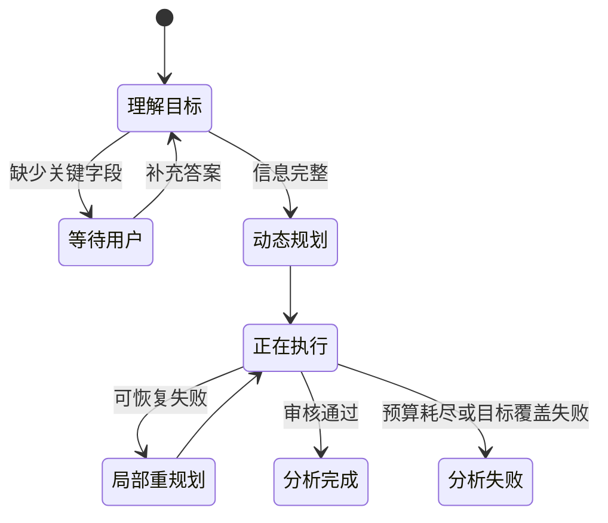

# Atlas 任务工作流

Atlas 不使用一条固定流程处理所有请求。下面展示三类典型任务及用户澄清链。

## 1. 基础 GIS：Buffer + Intersection

这条路径不会调用地形、遥感或新能源 Agent，体现按需调度而非全量执行。

## 2. 地形与遥感可用性分析

地形和遥感节点依赖同一个 AOI 数据节点，但二者互不依赖，可由 Harness 并行调度。
当前遥感验收只确认 STAC metadata；没有 scene geometry 时不绘制 footprint，没有下载
完整场景时也不会声称生成 RGB 或 NDVI。

## 3. 新能源选址复合任务

新能源选址通过 TaskGraph 组合共享能力。评分 Agent 不重复执行 GIS 运算，只消费前序
Evidence；正式冻结路径允许复用已验收的候选地缓存，并明确记录 Cache 状态。

## 4. 用户澄清与同 Job 续跑

澄清答案通过 `PATCH /v1/geo/jobs/{job_id}/clarification` 写入同一个 Job。系统保留
`goal_id` 和 AOI，创建新版本 GoalContract，然后重新进入 Router、Planner 和 Harness；
用户不需要从头描述任务。

## 5. 失败与恢复

1. Tool 错误被分类为可重试、不可重试或 Provider 故障。
2. 可重试错误按指数退避重试，并受最大尝试次数和总预算限制。
3. 连续 Provider 故障触发熔断并尝试备用来源。
4. Reviewer 发现局部问题时，只替换相关节点，不重跑已成功节点。
5. Worker 崩溃后从 SQLite Checkpoint 恢复，并校验已有 Artifact checksum。
